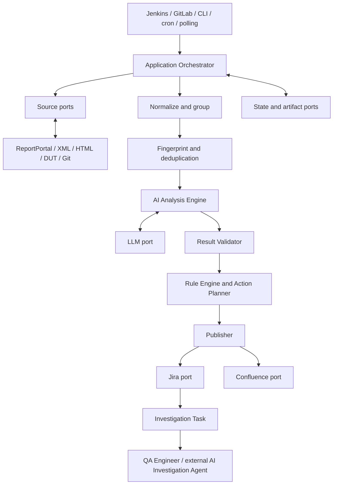

# Architecture

## Style and boundaries

A modular monolith using Ports and Adapters. CLI, scheduler and CI use the same application use cases. Domain owns entities and rules; application orchestrates; adapters interact with external systems. Dependencies point inward. The composition root selects implementations from validated configuration.



## Components

| Component | Responsibility |
|---|---|
| Run Discovery | Discover newly completed runs and campaigns without modifying test results |
| Orchestrator | Run context, steps, budgets, resume and independent status |
| Normalizer | Unified model, stable IDs, provenance and completeness |
| Failure Grouper | Primary/cascading and cross-stand groups; preserve all original failures |
| Fingerprint Engine | Deterministic normalization, algorithm version and scope |
| AI Analysis Engine | Analyze unknown groups with bounded context, hypotheses and structured output |
| Validator | Schema, real evidence references, completeness and evidence policy |
| Rule Engine | Pure deterministic function: facts + configuration -> decision |
| Defect Manager | Find candidates, match, prepare and execute Jira operations |
| Report Generator | Statistics from normalized data and template-based reports, not invented LLM figures |
| State Manager | Checkpoints, intent journal, reconciliation and fingerprint-to-Jira mapping |

## Ports (proposed names and responsibilities)

| Port | Operations | Adapters |
|---|---|---|
| RunDiscovery | discover(cursor, filters), get_status | ReportPortal |
| TestResultSource | load(run_ref) | ReportPortal, JUnit, HTML |
| LogSource | list_refs, read bounded range | ReportPortal, DUT/local, CI artifacts |
| SourceCodeProvider | resolve_sha, read_file | Git local, CI checkout, clone |
| LLMProvider | analyze(context, instructions, budget) | OpenAI-compatible |
| IssueTracker | search, get, create, comment, transition/link when enabled | Jira MCP / REST |
| FingerprintRegistry | find, record verified mapping | Jira custom field/label/description/property after validation; JSON cache |
| ReportPublisher | find, create, update | Confluence MCP / REST |
| StateStore | checkpoint, load, append intent/outcome | JSON; future implementations |
| ArtifactStore | put, get, resolve reference | filesystem; Jenkins/GitLab/ReportPortal retrieval adapters |

Read adapters return typed data and provenance. Write adapters return an external ID, confirmation or uncertain outcome. Check capabilities at startup according to the execution mode. REST fallback is allowed for an operation unsupported by MCP; never switch blindly to REST after a write timeout. Supply secrets via environment or corporate secret store.

## State and concurrency

JSON: per-run checkpoints, action plans, outcomes and fingerprint cache; write via temporary file and atomic replace, use local locking and directory permissions. Jira is the persistent defect and verified mapping registry. Confluence is the external report registry; ReportPortal holds test history. Select one canonical publisher for production MVP with a persistent volume/directory. Other environments run in dry-run or publish only when exclusivity and access to the current journal are assured. JSON plus Jira search does not provide exactly-once semantics or prevent distributed races. Reconcile uncertain outcomes; require manual resolution when reconciliation is impossible. No automatic parallel publication in MVP.

## Proposed implementation layout

```text
src/ai_test_analyzer/
  cli/
  domain/        # run, failure, analysis, decision, publication
  application/   # discover, analyze, plan, publish, resume
  ports/
  adapters/      # sources, git, llm, jira, confluence, storage
  bootstrap.py
config/
prompts/
templates/
integrations/    # Jenkins, GitLab, cron, Compose
skills/
tests/           # unit, contract, integration, evaluation, fixtures
docs/
```

Refine method names during implementation. Adapters should not become separate network services without a need. The core neither imports nor launches the AI Investigation Agent.

## Runtime baseline

CPython 3.14, Linux, uv and replaceable adapters. External MCP servers have independent runtimes and do not need to migrate to Python 3.14. See [dependencies.md](dependencies.md).
